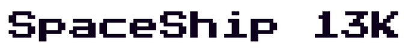
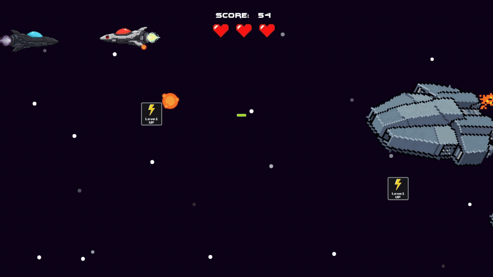
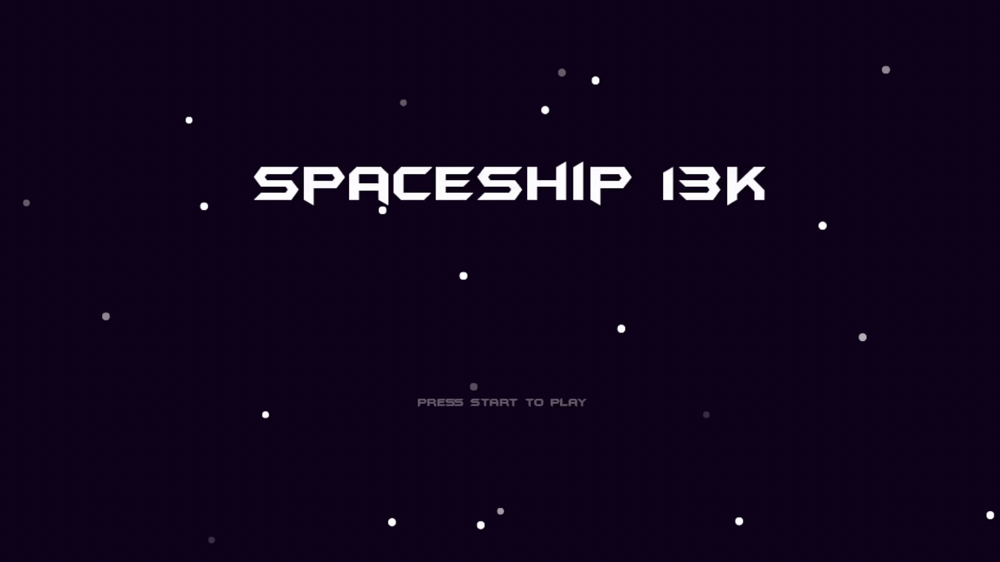
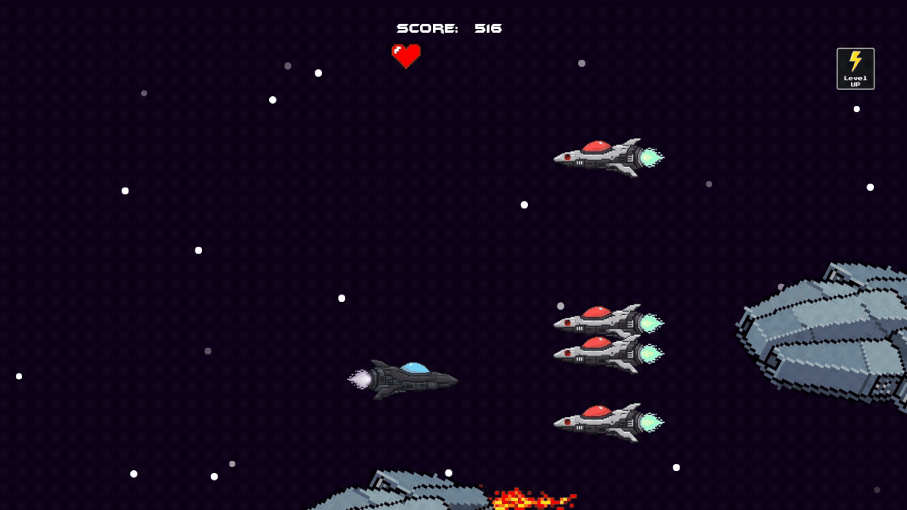
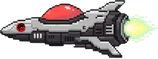
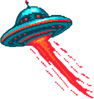
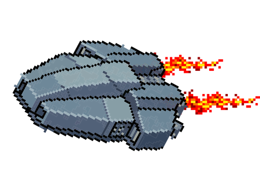

<div align="center">




</div>

---

<table>
  <tr>
    <td width="50%">
      Um jogo de tiro espacial 2D (Space Shooter) em Python + Pygame, desenvolvido para aplicar conceitos de Orientação a Objetos (POO) e aprimorar a lógica de programação na prática.<br>
    </td>
    <td>
      
    </td>
  </tr>
</table>

---

## 🎮 Funcionalidades (Features)

* **Menu e Telas:** Sistema completo de cenas, incluindo Tela Inicial (Menu), Jogo e Game Over, com efeitos de transição (Fade). <br>
 
* **Inimigos Variados:** 
  *  *SmallShip* : Rápida, mas fraca (1 vida).
  *  *MediumShip*: Velocidade média e resistente (3 vidas).
  *  *BigShip*: Lenta, mas funciona como um "mini-boss" (20 vidas).
* **Sistema de Power-Ups:** Colete itens para evoluir sua nave através de 8 níveis diferentes de tiro (aumentando a quantidade e o dano dos projéteis).
* **Animações e Efeitos:** Explosões animadas, sprites dinâmicos e background infinito (scrolling parallax).
* **Áudio:** Trilha sonora de fundo e efeitos sonoros para tiros, dano, colisões e coleta de power-ups.
* **HUD:** Sistema de pontuação em tempo real e exibição de vidas (corações).

---

## 🧠 Conceitos Aplicados

Este projeto foi desenvolvido com foco no aprimoramento da lógica de programação e na aplicação de boas práticas de engenharia de software. Os principais conceitos abordados incluem:

* **Programação Orientada a Objetos (POO):** 
  * Uso massivo de **Herança** e **Polimorfismo**. Por exemplo, classes como `SmallShip`, `MediumShip` e `PowerUp` herdam comportamentos da superclasse `Enemy` ou `Obj`, sobrescrevendo métodos específicos como `update()` para definir suas próprias animações e comportamentos.
* **Arquitetura e Modularização (Clean Code):** O código foge do padrão de um único arquivo gigante. A lógica foi dividida em múltiplos módulos dentro da pasta `scripts/` (como `scene.py`, `obj.py`, `text.py`), separando as responsabilidades de cada parte do jogo.
* **Gerenciamento de Estados (State Machine):** Criação de um sistema robusto de gerenciamento de cenas, permitindo transições fluidas entre as telas de *Menu*, *Gameplay* e *Game Over* sem quebrar o loop do jogo.
* **Lógica Matemática e Vetorial:** Uso de `pygame.math.Vector2()` para movimentação bidimensional da nave e cálculo de limites de tela.
* **Detecção de Colisão e Física Simples:** Implementação de grupos de sprites (`pygame.sprite.Group`) e verificação de colisões em tempo real (hitboxes) entre projéteis, nave principal e inimigos.
* **Manipulação de Mídia:** Carregamento, renderização e controle de opacidade (Alpha/Fade) de fontes customizadas, além de gerenciamento de canais de áudio para trilha sonora e efeitos.

---

## 🕹️ Controles

* `W` : Move a nave para Cima
* `S` : Move a nave para Baixo
* `A` : Move a nave para a Esquerda
* `D` : Move a nave para a Direita
* `ESPAÇO` : Atirar
* `ENTER` : Iniciar o jogo (Menu) / Voltar ao menu (Game Over)

---

## 📁 Estrutura do Projeto

O código foi construído com base em Orientação a Objetos (POO), dividiso da seguinte forma:

* **main.py**: Arquivo principal que executa o jogo.
* **src/**: Contém toda a lógica do jogo.
  * **startgame.py**: Gerenciador principal e loop do jogo.
  * **game.py**: Lógica principal de colisão, spawn de inimigos e HUD.
  * **scene.py**: Gerenciamento de cenas.
  * **menu.py**: Gerenciador do menu principal.
  * **gameover.py**: Gerenciador da tela de Game Over.
  * **obj.py**: Classe base para objetos e animações.
  * **animatedbg.py**: Lógica do cenário infinito (scrolling parallax).
  * **settings.py**: Configurações gerais de resolução (1280x720).
  * **text.py**: Gerenciamento, renderização de textos e fontes na tela (incluindo efeitos de fade).
* **assets/**: Pasta principal contendo todos os recursos de mídia do jogo
  * **explosao/**: Sprites e quadros de animação para os efeitos de destruição.
  * **hud/**: Ícones e elementos da interface, como o coração de vida.
  * **menu/**: Imagem de fundo do projeto.
  * **nave/**: Sprites da nave do jogador, das naves inimigas e dos power-ups.
  * **tiro/**: Sprites dos tiros do jogador.
  * **sons/**: Trilha sonora de fundo e efeitos sonoros do jogo (arquivos `.ogg`);
  * **font/**: Fonte de texto customizada (arquivo `.ttf`).
* **requirements.txt**: Lista de dependências (bibliotecas) necessárias para rodar o projeto.
* **README.md**: Arquivo principal de documentação do repositório.
* **readme-assets/**: Pasta contendo exclusivamente as imagens e GIFs utilizados para ilustrar esta documentação no GitHub.

---

## ⚙️ Como executar o projeto na sua máquina

### Pré-requisitos
Certifique-se de ter o [Python](https://www.python.org/) instalado em seu computador.

### Passo a Passo

1. **Clone o repositório:**
   ```bash
   git clone [https://github.com/MiguelBello-dev/spaceship-13k.git](https://github.com/MiguelBello-dev/spaceship-13k.git)

2. **Acesse a pasta do projeto:**
   ```bash
   cd spaceship-13k

3. **Crie um ambiente virtual (Opicional, mas recomendo):**
   ```bash
   python -m venv venv
   # Para ativar no Windows:
   venv/Scripts/activate
   # Para ativar no Linux/Mac:
   source venv/bin/activate

4. **Instale as dependências:**
   ```bash
   pip install -r requirements.txt

5. **Inicie o jogo:**
   ```bash
   python main.py

---

## 👨🏽‍💻 Desenvolvedor

Desenvolvido por **Miguel Bello Mendes**.